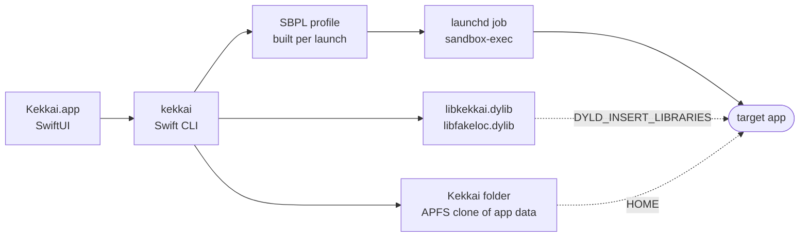

<div align="center">


# Kekkai

**Run Mac apps in isolation: each one sees only its own data and a device identity made just for it.**


[](LICENSE)

English · [简体中文](README.zh-CN.md)

[Quick start](#quick-start) · [Everyday use](#everyday-use) · [What an app sees](#what-an-app-sees) · [How it works](#how-it-works) · [Field notes](#field-notes) · [Limits](#limits)


<sub>One QQ session in Kekkai: 699 looks at other running programs, 40 local port probes, 16 scans for installed apps. All blocked.</sub>

</div>

Kekkai (結界, "barrier") wraps unmodified apps in macOS's kernel sandbox and, where the signature allows, a small injected library. There's no VM, no rule file to write for each app, and nothing the app's developer has to do. It's one native app: a SwiftUI window and a compiled command-line tool, with no Python or other runtime to install.

## Quick start

Kekkai needs macOS 14 or later and is a universal app for Apple silicon and Intel.

Download `Kekkai-0.1.dmg` from [the latest release](https://github.com/WJSGZZ/Kekkai/releases/latest), open it and drag Kekkai to Applications. The build is ad-hoc signed and not notarized, so macOS blocks the first launch; choose *Open Anyway* in System Settings › Privacy & Security.

To build from source instead (needs the Xcode Command Line Tools, `xcode-select --install`):

```bash
git clone https://github.com/WJSGZZ/Kekkai.git && cd Kekkai && ./install.sh
```

1. Quit the app you want to isolate. Kekkai can't wrap a copy that's already running.
2. Open Kekkai and click **+**, or drop the app onto the window. Adding is a trial run: the app joins only if it starts and keeps running for about 20 seconds, with any permission it can't do without switched on. If it fails, Kekkai says why (a paid App Store app checking its receipt, an app that isn't notarized, a failed code signature check) and removes what the trial created.
3. Double-click the app to open it in Kekkai. Single-click shows its Block Log and settings.

Launching the app from its own icon bypasses Kekkai, so open it through Kekkai or a launcher (below).

## Everyday use

- **Menu bar.** The Kekkai icon lists the apps running in Kekkai; choose one to switch to it. The light in the doorway is on while anything runs.
- **Pin to Top.** Pinned apps come first in the window and stay in the menu bar menu, ready to launch.
- **Launchers and the Dock.** Control-click an app and choose *Add a Launcher to Applications*. The launcher opens the app in Kekkai from the Dock or Spotlight; put it in the Dock in place of the original. Launchers, and injectable apps while they run in Kekkai, show the Kekkai badge on their icon, so you can tell them from the originals.
- **Moving files in.** Drag files straight into an injectable app, or paste them after confirming a prompt from Kekkai. A helper outside the sandbox hands the app a copy, without extras such as where the file was downloaded from; the original and its location stay hidden. For other apps, drop files on the app's icon in Kekkai's window to copy them into the app's Downloads.
- **Settings.** Each app's inspector has four panes: Activity (the Block Log), Access, Disguise and Files. The Block Log marks overreach with red dots, things worth a look with orange and routine requests with gray. When an app quits early, the blocked requests that are safe to allow come first, for a decision on each.

## What an app sees

Apps fall into two groups. *Injectable* apps get the injected library as well as the sandbox. *Not injectable* apps are those whose signature forbids injection; they get the sandbox only.

| | Injectable | Not injectable |
|---|---|---|
| **Files** | Its own Kekkai folder plus folders you approve. `~/.ssh`, `~/.gnupg` and `~/.aws` are always off-limits, approvals and symlinks included | Same |
| **User** | `user`, with the Kekkai folder as home, child processes included | User lookups are blocked |
| **Device identity** | Serial number, hardware UUID, network and Bluetooth addresses, disk and partition UUIDs, battery, chip, trackpad and display serials, display UUID and boot time are replaced with per-app values in the original format, so apps can't match each other | The same properties are blocked by name |
| **Network location** | ARP and neighbor entries are stripped from the routing table; `arp`, `netstat`, `ipconfig` and similar tools can't run | The IPv6 neighbor table can't be dumped (macOS already withholds IPv4 ARP entries from ordinary apps); the same tools can't run |
| **Local ports** | A private block of 32 ports; the sandbox allows only those. Ports the app opens are moved into the block, so its own parts still connect | Only its own block, which excludes the ports it opens itself; turn on *Ports on this Mac* when needed |
| **Local network** | Connections to local-network addresses (private, link-local, multicast) fail, and Bonjour browsing, resolving and registration are refused. DNS and a system proxy on the local network still work. Turn on *Devices on the local network* for screen mirroring and similar features | Governed by the macOS Local Network permission; keep it off in System Settings |
| **Language** | A single preferred language, with the region most common for it (China for Simplified Chinese). A language the app chose for itself is left alone | The system's language settings |
| **Clipboard** | Three modes. Default *Write, read on paste*: contents are readable only within 1.5 s of ⌘V or Paste | Off by default, drag and drop included |
| **Processes** | Every other process is *no such process*; the process table, the running-app list and the window list contain only the app, and the frontmost app is reported as none | Process info and the process table are blocked; the running-app and window lists stay visible |
| **Keychain** | One per app, inside its Kekkai folder, with a random password unlocked at launch. Your keychain can't be read or listed, and there's no option to open it. Apps that run in place get no keychain access | Same |
| **Also** | No login items, background items, privileged helpers or admin prompts, all of which macOS would start outside Kekkai. No Spotlight queries, so installed apps can't be listed that way. No launching other apps or sending Apple events. A per-app time zone: chosen, following the virtual location (looked up offline in the time zone boundaries that ship with macOS), or by default the zone in the language's usual region with exactly the same clock (Taipei becomes Shanghai). Virtual location for CoreLocation, with GCJ-02 handled | Same; virtual location switches to an injectable copy |

macOS itself redacts the Wi-Fi name and BSSID for apps without location permission.

Kekkai itself makes no network connections. The one exception is opt-in: *Choose on a Map* in the virtual-location picker loads Apple Maps. Preset cities and typed coordinates work offline.

## How it works



- **Kernel sandbox.** A fresh SBPL profile per launch: allow by default, then deny what matters (files, process info, hardware properties, local ports, launching other apps). Denied paths return *no such file*, not *permission denied*. The kernel enforces it, so the app can't opt out.
- **Injected library.** DYLD interposition answers on the system's behalf: a fake user, a per-app device identity, port remapping, a clipboard read gate and a process table that contains only the app.
- **Kekkai folder.** `/Users/Shared/Kekkai.noindex/<bundle id>`, with `HOME` pointed at it. On first launch Kekkai finds the app's existing data by bundle ID, app group and same-named data folders and brings it in as an APFS clone; the original stays untouched.

**Injectable copies.** Apps with the hardened runtime and library validation refuse injected code. When you add one, Kekkai first tries *Run as an injectable copy*: an ad-hoc signed APFS clone without the hardened runtime, which costs almost no disk space (about 7 MB for a 480 MB Electron app). If the copy fails its trial run, Kekkai falls back to the original. The switch is in the Disguise pane. Apps downloaded from the internet carry macOS's quarantine flag; an ad-hoc signed copy of them can't pass Gatekeeper, so they always run as the original.

**Apps that ship with Apple's App Sandbox**, such as QQ and WeChat, crash in the system sandbox's setup when wrapped by `sandbox-exec`. Kekkai runs a clone instead, stored in the Kekkai folder's `Applications`, stripped of the App Sandbox and of entitlements that need a developer certificate, and ad-hoc signed. That has consequences:

- The clone can't enter the original container (`~/Library/Containers/<id>`), because System Policy admits only the original signature. Its container data is cloned in when the copy is made, and *Import from Original…* in the Files pane refreshes it any time. macOS protects other apps' containers, so importing needs Full Disk Access for Kekkai; without it the import stops and offers to open the setting.
- Sign-in tokens are held per signature, so expect to sign in again and to re-grant camera and microphone access.
- When the original app updates, the clone is rebuilt on next launch. The two don't share data.
- The clone loses the App Sandbox's deny-by-default floor and relies on Kekkai's rules instead.

**Compared with Apple's App Sandbox.** Same kernel mechanism, opposite defaults. The App Sandbox denies everything and opens what the developer declares, if the developer opts in at all. Kekkai allows by default and closes the sensitive parts, which works on any app. The App Sandbox doesn't isolate ports either: in `/System/Library/Sandbox/Profiles/appsandbox-common.sb`, the network client entitlement expands to `(allow network-outbound (remote ip))`, any address and any port. For an app that already uses the App Sandbox, the clone trades Apple's floor for Kekkai's protections, which isn't strictly stronger; if you don't need the virtual location or the device identity, the original app is a fine choice.

## Field notes

Tested on macOS 27.2.

| App | Runs as | Result |
|---|---|---|
| Baidu Netdisk | Kekkai folder | Data carried over, still signed in. Probes every 32nd port from 7475 at launch; all blocked, app unaffected |
| Tencent Meeting (direct download) | In place | Remembers its data folder with a bookmark that breaks if moved, so its rule keeps it in place. Stays signed in |
| VooV Meeting (App Store) | Clone | Reaches sign-in with no errors; injection active |
| WeChat DevTools | Kekkai folder | Builds with *Ports on this Mac* off; all 6 ports it opens land in its block, no network denials logged |
| QQ, WeChat | Clone | Reach the QR sign-in screen. One QQ session: 699 process lookups, 40 port probes, 16 installed-app scans |
| Bandizip (paid, App Store) | — | Checks its purchase receipt (exit code 173), which a clone can't pass; refused at add time with the reason |

## Limits

- Not stealth: an app can tell it's sandboxed, and the user ID is real.
- An app that can't be injected, and whose copy won't run either, still sees the running-app and window lists, the display serial and UUID, and the computer name. They come from services every GUI app needs (LaunchServices, the window server, configd), so the sandbox can't block them. A computer name without your own name removes the last of these.
- Internet traffic isn't restricted. LAN devices are covered by macOS's Local Network permission; hiding your IP-based location needs a proxy.
- The Block Log sees only the denials macOS logs, and the log keeps only some repeats.
- Components macOS starts on its own, such as a cloud drive's sync extension or a helper installed before the app was added, run outside Kekkai. The app's settings list any it finds, running or installed.
- Apps that must run in place (such as Tencent Meeting's direct download) use your real home folder, so its path, including your account name, is visible to them.
- Gatekeeper and App Store receipt checks are not bypassed.
- Not built to stop software designed to escape. Apple has deprecated `sandbox-exec`, so retest after macOS updates.

## CLI and building

The UI drives `~/Library/Application Support/Kekkai/bin/kekkai`, which can do everything the UI can.

<details>
<summary>Common commands</summary>

```text
kekkai add|remove <App.app>                       add (with trial run) / remove
kekkai run|stop|blocked <App.app>                 launch / stop / export the Block Log
kekkai profile <App.app>                          print the sandbox profile without launching
kekkai list                                       all apps and settings as JSON
kekkai allow <id> add|rm <folder>                 approve a folder
kekkai set <id> localhost|procinfo|lan|clone on|off
kekkai set-clipboard <id> off|paste|on
kekkai set-open <id> on|off                       allow opening other apps and links
kekkai set-tz <id> <time zone|location|->
kekkai set-location <id> <lat> <lon> [name] | -
kekkai new-identity <id>                          new device identity
kekkai never list|add|rm [path]                   always-isolated paths
```

</details>

Per-app exceptions live in `rules/<bundle id>.json` and are kept to a minimum. Tencent Meeting's rule, for example, allows only the hex-named lock files it creates in `/tmp` and the home folder, and sets `"mode": "real"`.

`install.sh` signs with your Apple Development certificate if the keychain has one, so permissions such as Full Disk Access survive rebuilds; otherwise it signs ad hoc, and every rebuild needs them granted again. To give Kekkai to another Mac, `scripts/make-dmg.sh` builds a disk image. It's ad-hoc signed and not notarized, so the first launch needs approval in Privacy & Security.

## License

[MIT](LICENSE)
