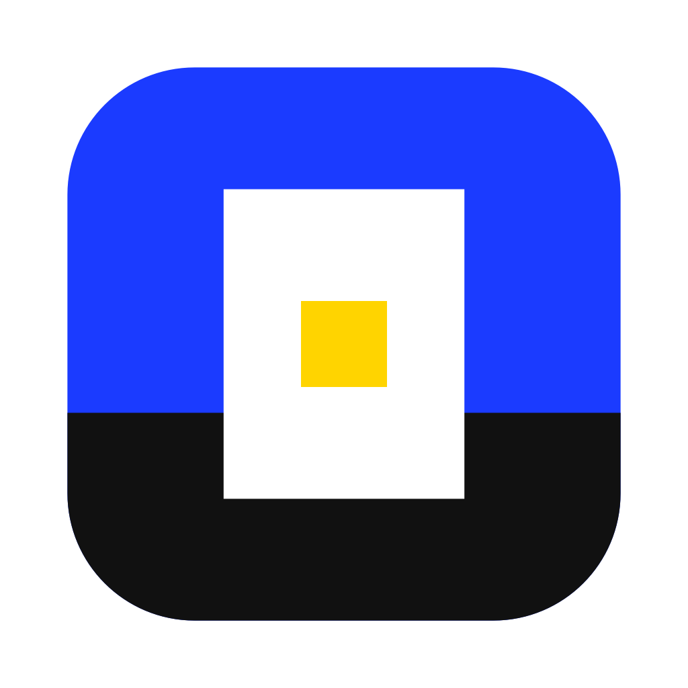

<div align="center">



# Kekkai

**Run a Mac app so it can only see its own data.**

*Kekkai* (結界) is Japanese for a protective barrier.

[English](README.md) · [简体中文](README.zh-CN.md)

</div>

Some apps scan your home folder, read your clipboard and leave files all over your Mac. Kekkai launches them inside macOS's built-in sandbox. The app keeps using its own data, so you stay signed in and keep your history, but your documents, desktop, downloads and other apps' data simply don't exist as far as it can tell. There's no virtual machine, and the app itself is never modified or re-signed.

## Quick start

You need macOS and the Xcode Command Line Tools (`xcode-select --install`).

```bash
git clone https://github.com/WJSGZZ/Kekkai.git
cd Kekkai
./install.sh
```

Open `~/Applications/Kekkai.app`, pick an app from the list (or drag one onto the window), and click **Open in Kekkai**.

Quit the app completely before opening it from Kekkai. Copies launched## Features

- **Only its own data.** The app reads and writes its own folders in `~/Library`, found by bundle ID and app name. Everything else gets "no such file", not "permission denied". That includes Downloads, Desktop, Documents, external drives and other apps' data.
- **Folders on request.** If the app needs somewhere to save downloads, allow a folder for it on the detail page. You can remove it any time.
- **Always-blocked folders.** These override every allowed folder, apply in Learn Mode too, and can't be reached through symlinks. The defaults are `~/.ssh`, `~/.gnupg` and `~/.aws`.
- **Hidden user name.** The app sees the user name `user`.
- **Clipboard blocking.** Cut an app off from the clipboard entirely, including drag and drop. Camera, microphone and location are left to macOS, which already controls them per app; the detail page links to the right System Settings pages.
- **Per-app time zone.** Each app can show its own time zone.
- **Virtual location.** Search for a place or click the map, and that's the location the app gets whenever it asks macOS. There's no permission prompt, and the real location never reaches the app. In mainland China, the map's GCJ-02 coordinates are converted to the GPS (WGS-84) coordinates apps expect. The app runs as a copy while this is on. Apps that work out your location from your IP address need a proxy instead.
- **Learn Mode.** Run an app once without isolation to log which outside paths it touches. Useful when writing rules for unusual apps.

The interface follows your system language (English or Chinese).

## Tested apps

Tested on macOS 27.2:

| App | Result |
|---|---|
| Baidu Netdisk | Starts on its existing data, stays signed in and fetches its file list. Downloads, Desktop and Documents are hidden, and an allowed folder can be read and written |
| Tencent Meeting | Starts on its existing data. At launch it probes for Chrome and ChatGPT, and both are blocked |
| WeChat DevTools | Starts on its existing data |
| QQ, WeChat | The unsandboxed copy reaches the QR sign-in screen. Running the copy on the existing data hasn't been tested yet |

With the clipboard blocked, the app can't reach the clipboard service at all. This goes further than macOS's own Paste from Other Apps setting, which only asks before an app reads the clipboard on its own.

## Apps with Apple's App Sandbox (QQ, WeChat)

Wrapped directly, these apps crash at launch inside macOS's own sandbox setup, however loose the Kekkai rules are. This happened with both QQ and WeChat. Instead, Kekkai makes an APFS clone of the app at `/Users/Shared/Kekkai/<bundle id>/Applications`, removes Apple's sandbox and any entitlements that need a developer certificate, re-signs the copy locally, and runs that copy inside Kekkai. The copy uses the app's original sandbox container (`~/Library/Containers/<bundle id>/Data`) as its home folder, so it works on the same data.

- The original app isn't touched, and opening it from its own icon works as before. When the original updates, the copy is rebuilt on the next launch.
- The clone takes almost no space. Only the re-signed files use extra disk.
- The copy is signed differently, so it can't read sign-in tokens the original saved in the keychain. You may need to sign in once, and you'll grant camera and microphone access again.
- Without Apple's sandbox, the copy is limited only by Kekkai's rules.

ple's sandbox, the copy is limited only by Kekkai's rules.

## Command line

The interface runs a Python script installed at `~/Library/Application Support/Kekkai/bin/kekkai`:

```text
kekkai run|learn|stop|report <App.app>
kekkai list
kekkai allow <bundle id> add|rm <folder>
kekkai set-tz <bundle id> <time zone|->
kekkai set-block <bundle id> clipboard <on|off>
kekkai set-location <bundle id> <latitude> <longitude> [name] | -
kekkai never list|add|rm [path]
```

A few apps need extra rules, which live in `rules/<bundle id>.json`. For example, Tencent Meeting creates lock files with random hex names in `/tmp` and in the home folder, and its `system_regex` allows only names like that.

The command line also keeps a disposable private space (`set-mode <bundle id> space`), where the app starts from scratch in its own home folder. It's handy for trying an app you don't trust yet.

## Limits

- Kekkai can't hide itself completely. An app can tell it's sandboxed, and the user ID is real.
- Only the time zone changes, not the clock. An app can still work out your location from your IP address or server time.
- A virtual location only replaces the macOS location API. An app that scans nearby Wi-Fi or uses your IP address may still find your real location.
- Network access isn't restricted.
- The keychain works as normal. The `block_keychain` rule blocks it, but sign-ins that rely on the keychain may then fail.
- Always-blocked folders are matched by path, so a hard link that already exists can still be read.
- System extensions, such as a cloud drive's sync extension, aren't restricted.
- It won't stop a program built to escape sandboxes. Apple has deprecated `sandbox-exec`, so a future macOS update could break Kekkai.

## License

[MIT](LICENSE)
