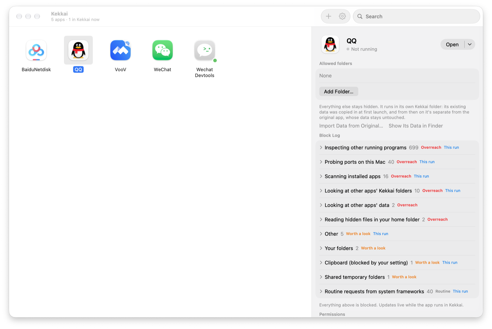
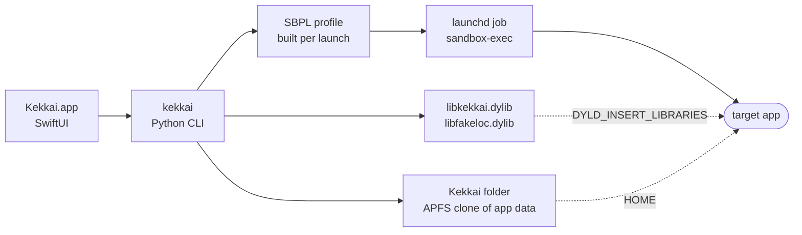

<div align="center">


# Kekkai

**Run Mac apps in isolation: each one sees only its own data and a device identity made just for it.**


[](LICENSE)

English · [简体中文](README.zh-CN.md)

[Quick start](#quick-start) · [How it works](#how-it-works) · [What an app sees](#what-an-app-sees) · [Field notes](#field-notes) · [CLI](#cli) · [Limits](#limits)



<sub>One QQ session in Kekkai: 699 looks at other processes, 40 local port probes, 16 scans for installed apps. All blocked.</sub>

</div>

Kekkai (結界, "barrier") wraps unmodified apps in macOS's kernel sandbox and, where the signature allows, a small injected library. No VM, no per-app rules to write, no help from the developer needed.

## Quick start

Requires macOS 14 or later and the Xcode Command Line Tools (`xcode-select --install`); the backend script runs on their Python.

```bash
git clone https://github.com/WJSGZZ/Kekkai.git && cd Kekkai && ./install.sh
```

Open Kekkai, then click **+** or drop an app onto the window. Adding an app is a trial run: it's added only if it starts within about 20 seconds, with any permission it can't live without switched on. If it fails, Kekkai says why (a paid App Store app checking its receipt, an unnotarized app, a failed code signature check) and cleans up. Double-click to launch in Kekkai; single-click for settings and the Block Log.

`install.sh` signs with your Apple Development certificate if the keychain has one, so permissions such as Full Disk Access survive rebuilds; otherwise it signs ad hoc and every rebuild needs them granted again.

Quit the app fully first; launching it from its own icon bypasses Kekkai. To ship Kekkai to another Mac, `scripts/make-dmg.sh` builds a disk image (ad-hoc signed and not notarized, so the first launch needs approval in Privacy & Security).

## How it works



- **Kernel sandbox.** A fresh SBPL profile per launch: allow by default, then deny what matters (files, process info, hardware properties, local ports, launching other apps). Denied paths return *no such file*, not *permission denied*. Enforced by the kernel, so the app can't opt out.
- **Injected library.** DYLD interposition answers on the system's behalf: a fake user, a per-app device identity, port remapping, a clipboard read gate and a process table that contains only the app. Works only for apps whose signature allows injection.
- **Kekkai folder.** `/Users/Shared/Kekkai.noindex/<bundle id>`, with `HOME` pointed at it. On first launch Kekkai finds the app's existing data by bundle ID, app group and same-named data folders, and brings it in as an APFS clone; the original stays untouched.

Apps with the hardened runtime and library validation can't be injected directly. When such an app is added, Kekkai first tries *Run as an injectable copy* and falls back to the original only if the copy fails its trial run. The copy is an ad-hoc signed APFS clone without the hardened runtime, costs almost no disk space (about 7 MB for a 480 MB Electron app), and gets everything in the Injectable column. The switch stays in Disguise. Apps downloaded from the internet carry macOS's quarantine flag, and an ad-hoc signed copy of them can't pass Gatekeeper, so they always run as the original. Apps that ship with Apple's App Sandbox, such as QQ and WeChat, run as an unsandboxed, ad-hoc re-signed clone that can be injected ([details](#apps-that-ship-with-apples-sandbox)).

## What an app sees

| | Injectable | Not injectable |
|---|---|---|
| **Files** | Its own Kekkai folder plus folders you approve. `~/.ssh`, `~/.gnupg` and `~/.aws` are always off-limits, approvals and symlinks included | Same |
| **User** | `user`, with the Kekkai folder as home, child processes included | User lookups are blocked |
| **Device identity** | Serial number, hardware UUID, network and Bluetooth addresses, disk and partition UUIDs, battery, chip, trackpad and display serials, display UUID, boot time: replaced with per-app values in the original format, so apps can't match each other | The same properties are blocked by name |
| **Network location** | ARP and neighbor entries are stripped from the routing table; `arp`, `netstat`, `ipconfig` and similar tools can't run | The IPv6 neighbor table can't be dumped (macOS already withholds IPv4 ARP entries from ordinary apps); the same tools can't run |
| **Local ports** | A private block of 32 ports; the sandbox allows only those. Ports the app opens are moved into the block, so its own parts still connect | Only its own block, which excludes the ports it opens itself; turn on Ports on this Mac when needed |
| **Local network** | Connections to local-network addresses (private, link-local, multicast) fail, and Bonjour browsing, resolving and registration are refused. DNS and a system proxy on the local network still work. Turn on Devices on the local network for screen mirroring and similar features | Governed by the macOS Local Network permission; keep it off in System Settings |
| **Language** | A single preferred language, with the region most common for it (China for Simplified Chinese). A language the app chose for itself is left alone | The system's language settings |
| **Clipboard** | Three modes. Default *Write, read on paste*: contents are readable only within 1.5 s of ⌘V or Paste | Off by default, drag and drop included |
| **Processes** | Every other process is *no such process*; the process table, the running-app list and the window list contain only the app, and the frontmost app is reported as none | Process info and the process table are blocked; the running-app and window lists stay visible |
| **Keychain** | One per app, inside its Kekkai folder, with a random password unlocked at launch. Your keychain can't be read or listed, and there is no option to open it. Apps that run in place get no keychain access | Same |
| **Also** | No login items, background items, privileged helpers or admin prompts, all of which macOS would start outside Kekkai; no Spotlight queries, so installed apps can't be listed that way; no launching other apps or sending Apple events; per-app time zone, which can follow the virtual location (looked up offline in the time zone boundary data included with macOS) and otherwise becomes the zone in that region with exactly the same clock (Taipei becomes Shanghai); virtual location (CoreLocation, with GCJ-02 handled) | Same; virtual location switches to an injectable clone |

macOS itself redacts the Wi-Fi name and BSSID for apps without location permission.

**Block Log.** While an app runs, the detail pane refreshes every few seconds with denials from the system log, grouped as Overreach, Worth a look and Routine. If the app quits early, the requests blocked just before it quit that can safely be allowed are listed first for a per-item decision. Locations that would expose other apps' data can never be allowed.

**Offline.** Kekkai itself makes no network connections. The one exception is opt-in: *Choose on a Map* in the virtual-location picker loads Apple Maps. Preset cities and typed coordinates work offline.

## Field notes

Tested on macOS 27.2.

| App | Runs as | Result |
|---|---|---|
| Baidu Netdisk | Kekkai folder | Data carried over, still signed in. Probes every 32nd port from 7475 at launch; all blocked, app unaffected |
| Tencent Meeting (direct download) | In place | Remembers its data folder with a bookmark that breaks if moved, so its rule keeps it in place. Stays signed in |
| VooV Meeting (App Store) | Clone | Reaches sign-in with no errors; injection active |
| WeChat DevTools | Kekkai folder | Builds with Ports on this Mac off; all 6 ports it opens land in its block, no network denials logged |
| QQ, WeChat | Clone | Reach the QR sign-in screen. One QQ session: 699 process lookups, 40 port probes, 16 installed-app scans |
| Bandizip (paid, App Store) | — | Checks its purchase receipt (exit code 173), which a clone can't pass; refused at add time with the reason |

## Apps that ship with Apple's sandbox

Such apps crash inside the system sandbox's initialization when wrapped by `sandbox-exec`, so Kekkai runs a clone: an APFS copy under the Kekkai folder's `Applications`, stripped of the App Sandbox and of entitlements that need a developer certificate, then ad-hoc signed.

- The clone can't enter the original container (`~/Library/Containers/<id>`); System Policy admits only the original signature (EPERM in testing). Its container data is cloned in when the copy is created, and *Import Data from Original* refreshes it any time. macOS protects other apps' containers, so this needs Full Disk Access for Kekkai; without it the import stops and offers to open the setting.
- Sign-in tokens are held by the system per signature, so expect to sign in again and to re-grant camera and microphone access.
- When the original app updates, the clone is rebuilt on next launch. The original keeps working; the two don't sync.
- The clone loses App Sandbox's deny-by-default floor and relies on Kekkai's rules.

## Compared with Apple's App Sandbox

Same kernel mechanism, opposite defaults. App Sandbox denies everything and opens what the developer declares, if the developer opts in at all. Kekkai allows by default and closes the sensitive parts, which works on any app without the developer.

App Sandbox doesn't isolate ports either. In `/System/Library/Sandbox/Profiles/appsandbox-common.sb`, the network client entitlement expands to `(allow network-outbound (remote ip))`: any address, any port. Kekkai's port blocks are an extra layer. For apps that already use App Sandbox, the clone trades Apple's floor for Kekkai's protections, which is not strictly stronger; if you don't need the virtual location or device identity, the original app is a fine choice.

## CLI

The UI drives `~/Library/Application Support/Kekkai/bin/kekkai`, which can do everything the UI can.

<details>
<summary>Common commands</summary>

```text
kekkai add|remove <App.app>                       add (with trial run) / remove
kekkai run|stop|blocked <App.app>                 launch / stop / export the Block Log
kekkai list                                       all apps and settings as JSON
kekkai allow <id> add|rm <folder>                 approve a folder
kekkai set <id> localhost|procinfo|clone on|off
kekkai set-clipboard <id> off|paste|on
kekkai set-open <id> on|off                       allow opening other apps and links
kekkai set-tz <id> <time zone|->
kekkai set-location <id> <lat> <lon> [name] | -
kekkai new-identity <id>                          new device identity
kekkai never list|add|rm [path]                   always-isolated paths
```

</details>

Per-app exceptions live in `rules/<bundle id>.json` and are kept to a minimum. Tencent Meeting's rule, for example, allows only the hex-named lock files it creates in `/tmp` and the home folder, and sets `"mode": "real"`.

## Limits

- Not stealth: an app can tell it's sandboxed, and the user ID is real.
- An app that can't be injected and whose copy fails to run still sees the running-app and window lists, the display serial and UUID, and the computer name. They come from services every GUI app needs (LaunchServices, the window server, configd), so the sandbox can't block them. A computer name without your own name removes the last of these.
- Internet traffic isn't restricted. LAN devices are covered by macOS's Local Network permission; IP-based location needs a proxy.
- The Block Log sees only denials the system logs, and the log keeps only some repeats.
- Components macOS starts on its own, such as a cloud drive's sync extension or a helper installed before the app was added, run outside Kekkai. The app's settings list any it finds, running or installed.
- Apps that must run in place (such as Tencent Meeting's direct download) use your real home folder, so its path, including your account name, is visible to them.
- Gatekeeper and App Store receipt checks are not bypassed.
- Not built to stop software designed to escape. Apple has deprecated `sandbox-exec`; retest after macOS updates.

## License

[MIT](LICENSE)
