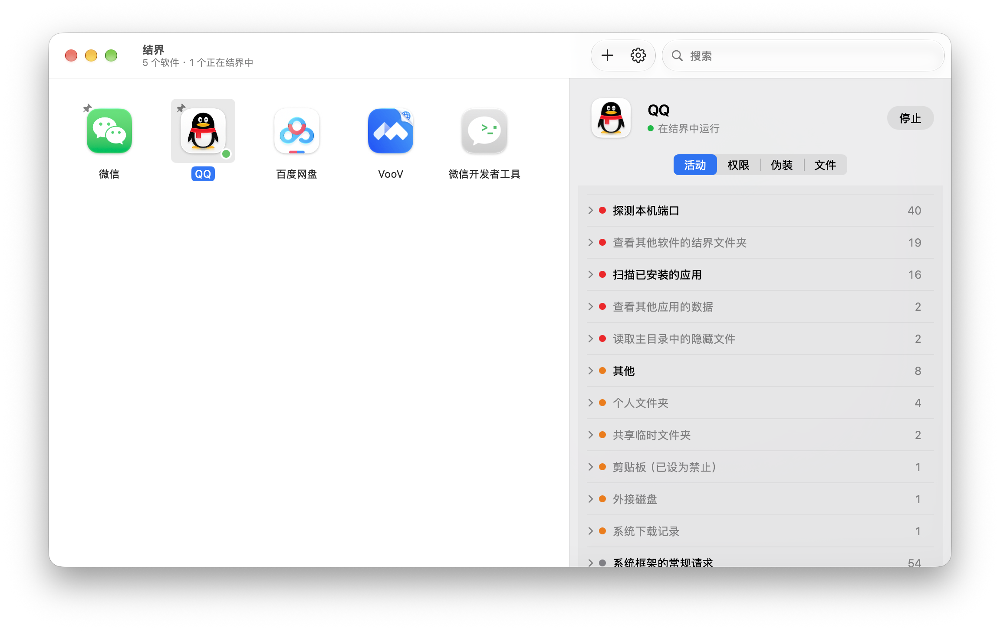
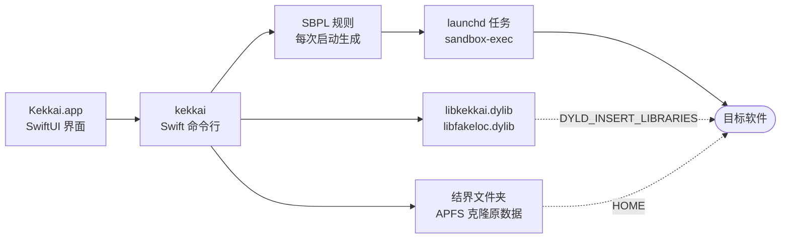

<div align="center">


# 结界 Kekkai

**让 Mac 上的每个软件只看得到自己的数据，和一套只属于它的设备信息。**


[](LICENSE)

[English](README.md) · 简体中文

[快速开始](#快速开始) · [日常使用](#日常使用) · [隔离了什么](#隔离了什么) · [工作原理](#工作原理) · [实测](#实测) · [局限](#局限)



<sub>QQ 在结界里运行一次：查看其他程序 699 次、探测本机端口 40 次、扫描已装应用 16 次，全部被挡下。</sub>

</div>

结界把软件原样放进 macOS 的内核沙盒，签名允许时再注入一个小库，替系统回答那些会认出你的问题。不用虚拟机，不用逐个写规则，也不需要软件开发者配合。它是一个原生 App：SwiftUI 界面加一个编译好的命令行，不需要另装 Python 或其他运行环境。

## 快速开始

支持 macOS 14 及以上，Apple 芯片和 Intel 通用。从源码构建需要 Xcode 命令行工具（`xcode-select --install`）。

```bash
git clone https://github.com/WJSGZZ/Kekkai.git && cd Kekkai && ./install.sh
```

1. 先完全退出要隔离的软件，已经在运行的那份无法放进结界。
2. 打开“结界”，点 **+** 或把软件拖进窗口。添加即试运行：约 20 秒内能启动并保持运行才加入，缺的权限顺带打开；起不来就说明原因（App Store 付费软件校验购买凭证、未经 Apple 公证、代码签名校验未通过等），并清除这次试运行产生的文件。
3. 双击图标在结界中打开，单击查看拦截记录和设置。

从软件自己的图标打开不受结界限制，请经结界或下面的入口打开。

## 日常使用

- **菜单栏**：结界图标列出正在结界中运行的软件，选一个即切换过去；门里的灯亮着，表示有软件在运行。
- **置顶**：右键选“置顶”，软件排在窗口最前，并常驻菜单栏菜单，点一下就在结界中打开。
- **入口与程序坞**：右键选“在‘应用程序’中创建入口”，入口从程序坞或聚焦搜索打开软件时自动进入结界，可放进程序坞代替原版。入口的图标，以及可注入软件在结界中运行时的程序坞图标，右下角都带结界标志，和原版一眼可分。
- **传入文件**：可注入的软件可以直接拖入文件，粘贴文件时由结界弹出提示确认。结界外的中转程序复制一份交给软件，并去掉下载来源等附加信息，原文件和原位置对软件不可见。其他软件请把文件拖到结界窗口里它的图标上，复制进它的“下载”文件夹。
- **设置**：每个软件的设置分活动、权限、伪装、文件四页，默认显示“活动”里的拦截记录。红点为越权，橙点为留意，灰点为常规。软件异常退出时，退出前被挡、又可以放行的请求排在最前，逐条允许或拒绝；会放出别的软件数据的位置不能放行。

## 隔离了什么

“能注入”指签名允许注入的软件，沙盒和注入库两层都生效；“不能注入”的软件只有沙盒这一层。

| | 能注入的软件 | 不能注入的软件 |
|---|---|---|
| **文⁠件** | 只见自己的结界文件夹和你批准的文件夹；`~/.ssh`、`~/.gnupg`、`~/.aws` 永远隔离，批准和符号链接都绕不过 | 同左 |
| **用⁠户⁠名** | 答 `user`，家目录是结界文件夹，子进程也一样 | 系统用户查询直接挡掉 |
| **设⁠备⁠信⁠息** | 序列号、硬件 UUID、网卡与蓝牙地址、磁盘与分区 UUID、电池／芯片／触控板／显示器序列号、显示器 UUID、开机时间，按软件换成格式相同的假值，软件之间对不上号 | 同一批属性按名字挡掉 |
| **网⁠络⁠位⁠置** | 路由表里的 ARP 和邻居条目删掉；`arp`、`netstat`、`ipconfig` 等工具禁止运行 | IPv6 邻居表不许整表导出（IPv4 的 ARP 条目系统本就不给普通程序）；工具同样禁止运行 |
| **本⁠机⁠端⁠口** | 每个软件一组 32 个专用端口，沙盒只许连这组；它自己开的端口由注入库挪进这组，自身组件照常互连 | 只能连自己那组，自己开的端口也连不上，需要时打开“本机端口” |
| **局⁠域⁠网** | 连接局域网地址（私有、链路本地、组播）均失败，Bonjour 的浏览、解析和注册被拒；DNS 和设在局域网的系统代理不受影响。投屏等功能需打开“局域网设备” | 由 macOS 的“本地网络”权限控制，建议在系统设置中保持关闭 |
| **语⁠言** | 首选语言只保留一种，地区取该语言最常见的地区（简体中文对应中国）；软件自行选择的语言不变 | 使用系统的语言设置 |
| **剪⁠贴⁠板** | 三档，默认“可写入，粘贴时可读”：按 ⌘V 或点“粘贴”后 1.5 秒内才读得到内容 | 默认整个挡掉，拖放一起 |
| **进⁠程** | 别的进程一律“没有这个进程”；进程表、运行中的软件列表和窗口列表只有自己，前台软件答“无” | 进程信息和进程表都挡掉；运行中的软件和窗口列表仍可见 |
| **钥⁠匙⁠串** | 每个软件一份，放在自己的结界文件夹，密码随机、启动前自动解锁；你的钥匙串无法读取或列出，也不提供开放选项。原地运行的软件不能使用钥匙串 | 同左 |
| **其⁠他** | 禁止注册登录项、后台项目和特权助手，禁止申请管理员权限，这些都会由系统在结界外启动；禁止聚焦搜索，无法借此列出已装软件；不许拉起别的软件、不许发自动化指令。时区按软件设置：可手动选择，可跟随虚拟位置（离线查 macOS 自带的时区边界数据），未设置时换为该语言常见地区中钟点完全相同的时区（台北换为上海）。虚拟位置替换 CoreLocation 的结果，自动处理 GCJ-02 | 同左；虚拟位置会改用可注入的副本 |

Wi-Fi 名称和 BSSID 由系统对没有定位权限的程序打码，两类软件都读不到。

结界本身不联网。唯一例外需手动触发：虚拟位置中的“在地图上选择”会加载 Apple 地图；常用城市和手动输入坐标均离线完成。

## 工作原理



三层各管一段：

| 层 | 做什么 | 能否绕过 |
|---|---|---|
| **系⁠统⁠沙⁠盒** | 每次启动生成一份 SBPL：默认放行，再挡住文件、进程、硬件属性、本机端口、拉起其他软件等要害。被挡的文件一律答“没有这个文件”，不答“没有权限” | 内核执行，绕不过 |
| **注⁠入⁠库** | 用 DYLD interpose 替系统回答：假用户名、按软件生成的一套设备信息、端口改道、剪贴板读取闸门、只含自己的进程表 | 只对签名允许注入的软件生效 |
| **结⁠界⁠文⁠件⁠夹** | `/Users/Shared/Kekkai.noindex/<软件 id>`，`HOME` 指向这里。首次打开按软件 ID、群组容器和同名数据文件夹认出原数据，用 APFS 克隆带进来，原数据不动 | — |

**可注入副本。** 带强化运行时、又没放开库校验的软件拒绝外来代码，原版只能靠沙盒挡。添加这类软件时，结界先试“以可注入副本运行”：去掉强化运行时、临时签名的 APFS 克隆，几乎不占空间（480 MB 的 Electron 软件约多 7 MB），享有“能注入”一栏的全部伪装；副本试运行失败才改用原版。开关在“伪装”页。从网上下载的软件带 macOS 的隔离标记，临时签名的副本过不了门禁，因此始终以原版运行。

**自带苹果沙盒的软件**，如 QQ、微信，直接套进 `sandbox-exec` 会崩在系统沙盒的初始化里。结界改为运行它的副本：克隆到结界文件夹的 `Applications` 下，去掉苹果沙盒和需要开发者证书的权限，临时签名。随之而来的是：

- 副本进不了原容器 `~/Library/Containers/<id>`，系统策略只认原签名。创建副本时把容器数据克隆一份给它，之后可在“文件”页随时“从原 App 导入…”。macOS 保护其他 App 的容器，导入需为结界开启“完全磁盘访问权限”；未开启时导入将中止，并提供前往设置的按钮。
- 登录凭据由系统按签名保管，副本拿不到，要重新扫码；摄像头、麦克风等权限也要重新授权。
- 原 App 更新后，副本下次打开时自动重建；两边数据互不同步。
- 副本少了苹果沙盒“没写就不许”的底线，限制全靠结界规则。

**和苹果的 App 沙盒比。** 同一套内核机制，方向相反：App 沙盒默认全禁、按声明开放，开不开由开发者决定；结界默认放行、挡住要害，不需要开发者配合。App 沙盒也不隔离端口：本机 `/System/Library/Sandbox/Profiles/appsandbox-common.sb` 里，联网权限展开就是 `(allow network-outbound (remote ip))`，任意地址、任意端口。对已有苹果沙盒的软件，副本多了结界的保护、少了苹果沙盒的底线，不一定整体更严；用不到虚拟位置和设备伪装时，直接用原版也可以。

## 实测

macOS 27.2：

| 软件 | 运行方式 | 结果 |
|---|---|---|
| 百⁠度⁠网⁠盘 | 结⁠界⁠文⁠件⁠夹 | 自动带入原数据，保持登录，文件列表正常；启动时从 7475 起每隔 32 个端口探测，全部被挡，照常运行 |
| 腾⁠讯⁠会⁠议⁠（⁠官⁠网⁠版⁠） | 原⁠地⁠运⁠行 | 用书签记数据位置，移动后失效，规则写明原地运行；保持登录 |
| 腾讯会议（VooV，App Store 版） | 副⁠本 | 到登录页无报错，注入生效 |
| 微⁠信⁠开⁠发⁠者⁠工⁠具 | 结⁠界⁠文⁠件⁠夹 | 关闭“本机端口”时编译正常，它开的 6 个端口全部挪进配额，系统日志没有网络拒绝 |
| Q⁠Q⁠、⁠微⁠信 | 副⁠本 | 启动到扫码登录页；QQ 一次运行查看其他程序 699 次、探测端口 40 次、扫描已装应用 16 次 |
| Bandizip（App Store 付费版） | — | 校验购买凭证（退出码 173），副本通不过，添加时说明原因并拒绝 |

## 局限

- 不是隐身：软件能发现自己在沙盒里，用户 ID 是真的。
- 不能注入、副本也无法运行的软件，仍能看到运行中的软件和窗口列表、显示器序列号和 UUID、电脑名：它们来自图形软件必需的系统服务（LaunchServices、窗口服务器、configd），沙盒无法屏蔽。电脑名不含本人姓名即可消除最后一项。
- 外网不限制；局域网设备交给系统“本地网络”权限；隐藏按 IP 判断的位置要靠代理。
- 拦截记录只来自系统日志里的拒绝记录，同一请求只记一部分。
- 系统自行启动的组件（如网盘的同步扩展、添加前已装好的助手）在结界外运行；软件设置中会列出检测到的此类组件，包括正在运行的和已安装的。
- 必须原地运行的软件（如腾讯会议官网版）使用真实的主目录，其路径中的账户名对它可见。
- 不绕过 Gatekeeper 和 App Store 收据校验。
- 不防专门设计的逃逸程序。`sandbox-exec` 已被苹果标为弃用，系统升级后要先回归测试。

## 命令行与构建

界面背后是 `~/Library/Application Support/Kekkai/bin/kekkai`，界面能做的它都能做。

<details>
<summary>常用命令</summary>

```text
kekkai add|remove <App.app>                       添加（含试运行）／移除
kekkai run|stop|blocked <App.app>                 启动／停止／导出拦截记录
kekkai profile <App.app>                          打印将使用的沙盒规则，不启动
kekkai list                                       所有软件及设置（JSON）
kekkai allow <id> add|rm <文件夹>                 批准文件夹
kekkai set <id> localhost|procinfo|lan|clone on|off
kekkai set-clipboard <id> off|paste|on
kekkai set-open <id> on|off                       允许打开其他软件和链接
kekkai set-tz <id> <时区|location|->
kekkai set-location <id> <纬度> <经度> [名称] | -
kekkai new-identity <id>                          换一套设备信息
kekkai never list|add|rm [路径]                   必定隔离的路径
```

</details>

个别软件的额外放行写在 `rules/<软件 id>.json`，越少越好。例如腾讯会议的规则只放行它在 `/tmp` 和家目录建的十六进制锁文件，并写明 `"mode": "real"`。

`install.sh` 优先使用钥匙串中的 Apple Development 证书签名，完全磁盘访问权限等授权在重新构建后仍然有效；无证书时使用临时签名，每次构建后需重新授权。分发给别的 Mac 用 `scripts/make-dmg.sh` 打安装映像；它是临时签名、未公证的，首次打开需在“隐私与安全性”里允许。

## 许可

[MIT](LICENSE)
