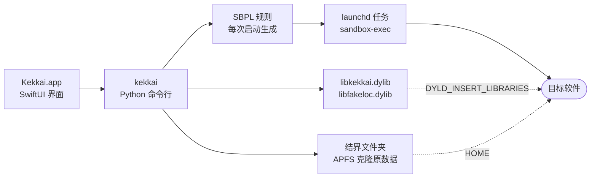

<div align="center">


# 结界 Kekkai

**让 Mac 上的每个软件只看得到自己的数据，和一套只属于它的设备信息。**


[](LICENSE)

[English](README.md) · 简体中文

[快速开始](#快速开始) · [工作原理](#工作原理) · [隔离了什么](#隔离了什么) · [实测](#实测) · [命令行](#命令行) · [局限](#局限)


<sub>QQ 在结界里运行一次：查看其他程序 699 次、探测本机端口 40 次、扫描已装应用 16 次，全部被挡下。</sub>

</div>

## 快速开始

需要 macOS 14 以上和 Xcode 命令行工具（`xcode-select --install`，后台脚本用它自带的 Python）。

```bash
git clone https://github.com/WJSGZZ/Kekkai.git && cd Kekkai && ./install.sh
```

打开“结界”，点 **+** 或把软件拖进窗口。添加就是一次试运行：约 20 秒内能正常启动才加入，缺的权限顺带打开；起不来就说明原因并清理现场，比如“App Store 付费软件会校验购买凭证”“未经 Apple 公证”“代码签名校验未通过”。之后双击图标在结界中打开，单击查看设置和拦截记录。

`install.sh` 优先使用钥匙串中的 Apple Development 证书签名，完全磁盘访问权限等授权在重新构建后仍然有效；无证书时使用临时签名，每次构建后需重新授权。

先完全退出原软件再从结界打开；从原图标打开的不受限制。分发给别的 Mac 用 `scripts/make-dmg.sh` 打安装映像（临时签名、未公证，首次打开需在“隐私与安全性”里允许）。

## 工作原理



三层各管一段：

| 层 | 做什么 | 能否绕过 |
|---|---|---|
| **系⁠统⁠沙⁠盒** | 每次启动生成一份 SBPL：默认放行，再挡住文件、进程、硬件属性、本机端口、拉起其他软件等要害。被挡的文件一律答“没有这个文件”，不答“没有权限” | 内核执行，绕不过 |
| **注⁠入⁠库** | 用 DYLD interpose 替系统回答：假用户名、按软件生成的一套设备信息、端口改道、剪贴板读取闸门、只含自己的进程表 | 只对签名允许注入的软件生效 |
| **结⁠界⁠文⁠件⁠夹** | `/Users/Shared/Kekkai.noindex/<软件 id>`，`HOME` 指向这里。首次打开按软件 ID、群组容器和同名数据文件夹认出原数据，用 APFS 克隆带进来，原数据不动 | — |

能否注入看签名：带强化运行时、又没放开库校验的软件不能注入，原版只靠沙盒挡。添加这类软件时，结界先试“以可注入副本运行”：运行去掉强化运行时、临时签名的 APFS 克隆，几乎不占空间（480 MB 的 Electron 软件约多 7 MB），享有“能注入”一栏的全部伪装；副本试运行失败才改用原版。开关在“伪装”一栏。从网上下载的软件带 macOS 的隔离标记，临时签名的副本过不了门禁，因此始终以原版运行。QQ、微信这类自带苹果沙盒的软件，结界运行的是去掉苹果沙盒、临时重签的副本，副本可以注入（见[下文](#自带苹果沙盒的软件)）。

## 隔离了什么

| | 能注入的软件 | 不能注入的软件 |
|---|---|---|
| **文⁠件** | 只见自己的结界文件夹和你批准的文件夹；`~/.ssh`、`~/.gnupg`、`~/.aws` 永远隔离，批准和符号链接都绕不过 | 同左 |
| **用⁠户⁠名** | 答 `user`，家目录是结界文件夹，子进程也一样 | 系统用户查询直接挡掉 |
| **设⁠备⁠信⁠息** | 序列号、硬件 UUID、网卡与蓝牙地址、磁盘与分区 UUID、电池／芯片／触控板／显示器序列号、显示器 UUID、开机时间，按软件换成格式相同的假值，软件之间对不上号 | 同一批属性按名字挡掉 |
| **网⁠络⁠位⁠置** | 路由表里的 ARP 和邻居条目删掉；`arp`、`netstat`、`ipconfig` 等工具禁止运行 | IPv6 邻居表不许整表导出（IPv4 的 ARP 条目系统本就不给普通程序）；工具同样禁止运行 |
| **本⁠机⁠端⁠口** | 每个软件一组 32 个专用端口，沙盒只许连这组；它自己开的端口由注入库挪进这组，自身组件照常互连 | 只能连自己那组，自己开的端口也连不上，需要时打开“本机端口” |
| **剪⁠贴⁠板** | 三档，默认“可写入，粘贴时可读”：按 ⌘V 或点“粘贴”后 1.5 秒内才读得到内容 | 默认整个挡掉，拖放一起 |
| **进⁠程** | 别的进程一律“没有这个进程”；进程表、运行中的软件列表和窗口列表只有自己，前台软件答“无” | 进程信息和进程表都挡掉；运行中的软件和窗口列表仍可见 |
| **钥⁠匙⁠串** | 每个软件一份，放在自己的结界文件夹，密码随机、启动前自动解锁；你的钥匙串无法读取或列出，也不提供开放选项。原地运行的软件不能使用钥匙串 | 同左 |
| **其⁠他** | 禁止注册登录项、后台项目和特权助手，禁止申请管理员权限（这些都由系统在结界外启动）；禁止聚焦搜索，无法借此列出已装软件；不许拉起别的软件、不许发自动化指令；独立时区；虚拟位置（替换 CoreLocation，自动处理 GCJ-02） | 同左；虚拟位置会改用可注入的副本 |

Wi-Fi 名称和 BSSID 由系统对没有定位权限的程序打码，两类软件都读不到。

**拦截记录**：运行中每几秒从系统日志刷新被挡下的请求，分越权、留意、常规三档。软件异常退出时，退出前被挡、又可以放行的请求排在最前，逐条允许或拒绝；会放出别人数据的位置不能放行。

**不联网**：结界本身不发起网络连接。唯一例外需手动触发：虚拟位置中的“在地图上选择”会加载 Apple 地图；常用城市和手动输入坐标均离线完成。

## 实测

macOS 27.2：

| 软件 | 运行方式 | 结果 |
|---|---|---|
| 百⁠度⁠网⁠盘 | 结⁠界⁠文⁠件⁠夹 | 自动带入原数据，保持登录，文件列表正常；启动时从 7475 起每隔 32 个端口探测，全部被挡，照常运行 |
| 腾⁠讯⁠会⁠议⁠（⁠官⁠网⁠版⁠） | 原⁠地⁠运⁠行 | 用书签记数据位置，搬走就失效，规则写明原地运行；保持登录 |
| 腾讯会议（VooV，App Store 版） | 副本 | 到登录页无报错，注入生效 |
| 微⁠信⁠开⁠发⁠者⁠工⁠具 | 结⁠界⁠文⁠件⁠夹 | 关闭“本机端口”时编译正常，它开的 6 个端口全部挪进配额，系统日志没有网络拒绝 |
| QQ、微信 | 副本 | 启动到扫码登录页；QQ 一次运行查看其他程序 699 次、探测端口 40 次、扫描已装应用 16 次 |
| Bandizip（App Store 付费版） | — | 校验购买凭证（退出码 173），副本通不过，添加时说明原因并拒绝 |

## 自带苹果沙盒的软件

这类软件直接套进 `sandbox-exec` 会崩在系统沙盒初始化里，所以结界运行它的副本：APFS 克隆到结界文件夹的 `Applications` 下，去掉苹果沙盒和需要开发者证书的权限，临时签名。

- 副本进不了原容器 `~/Library/Containers/<id>`，系统策略只认原签名（实测 EPERM，来自 System Policy）。首次创建副本时把容器数据克隆一份给它，之后可随时“从原 App 导入数据”。macOS 保护其他 App 的容器，此操作需为结界开启“完全磁盘访问权限”；未开启时导入将中止，并提供前往设置的按钮。
- 登录凭据由系统按签名保管，副本拿不到，要重新扫码；摄像头、麦克风等权限也要重新授权。
- 原 App 更新后，副本下次打开时自动重建。原 App 照常可用，两边数据不同步。
- 副本少了苹果沙盒“没写就不许”的底线，限制全靠结界规则。

## 和苹果的 App 沙盒比

同一套内核机制，方向相反。App 沙盒默认全禁、按声明开放，开不开由开发者决定；结界默认放行、挡住要害，不需要开发者配合，任何软件都能套。

App 沙盒也不隔离端口：本机 `/System/Library/Sandbox/Profiles/appsandbox-common.sb` 里，联网权限展开就是 `(allow network-outbound (remote ip))`，任意地址、任意端口。结界的端口配额是额外补的一层。对已有苹果沙盒的软件，副本多了结界的保护、少了苹果沙盒的底线，不一定整体更严；用不到虚拟位置和设备伪装时，直接用原版也可以。

## 命令行

界面背后是 `~/Library/Application Support/Kekkai/bin/kekkai`，界面能做的它都能做。

<details>
<summary>常用命令</summary>

```text
kekkai add|remove <App.app>                       添加（含试运行）／移除
kekkai run|stop|blocked <App.app>                 启动／停止／导出拦截记录
kekkai list                                       所有软件及设置（JSON）
kekkai allow <id> add|rm <文件夹>                 批准文件夹
kekkai set <id> localhost|procinfo|clone on|off
kekkai set-clipboard <id> off|paste|on
kekkai set-open <id> on|off                       允许打开其他软件和链接
kekkai set-tz <id> <时区|->
kekkai set-location <id> <纬度> <经度> [名称] | -
kekkai new-identity <id>                          换一套设备信息
kekkai never list|add|rm [路径]                   必定隔离的路径
```

</details>

个别软件的额外放行写在 `rules/<软件 id>.json`，越少越好。例如腾讯会议的规则只放行它在 `/tmp` 和家目录建的十六进制锁文件，并写明 `"mode": "real"`。

## 局限

- 不是隐身：软件能发现自己在沙盒里，用户 ID 是真的。
- 不能注入、副本也无法运行的软件，仍能看到运行中的软件和窗口列表、显示器序列号和 UUID、电脑名：它们来自图形软件必需的系统服务（LaunchServices、窗口服务器、configd），沙盒无法屏蔽。电脑名不含本人姓名即可消除最后一项。
- 外网不限制；局域网设备交给系统“本地网络”权限；按 IP 定位要靠代理。
- 拦截记录只来自系统日志里的拒绝记录，同一请求只记一部分。
- 系统自行启动的组件（如网盘的同步扩展、添加前已装好的助手）在结界外运行；软件设置中会列出检测到的此类组件，包括正在运行的和已安装的。
- 必须原地运行的软件（如腾讯会议官网版）使用真实的主目录，其路径中的账户名对它可见。
- 不绕过 Gatekeeper 和 App Store 收据校验。
- 不防专门设计的逃逸程序。`sandbox-exec` 已被苹果标为弃用，系统升级后要先回归测试。

## 许可

[MIT](LICENSE)
